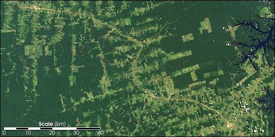
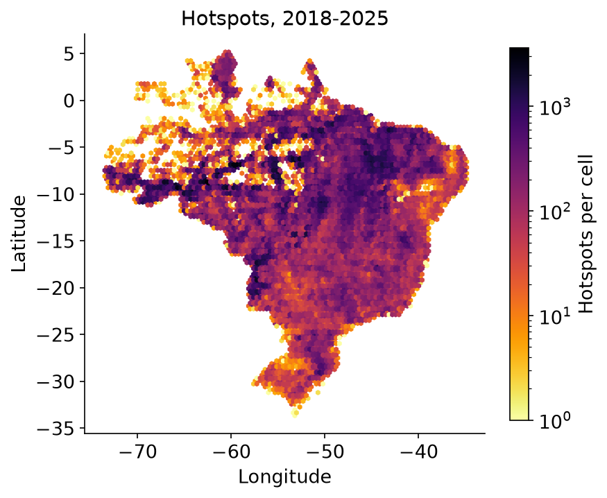
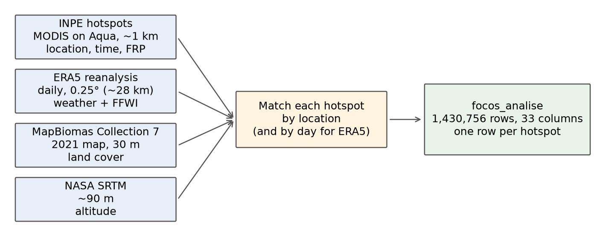
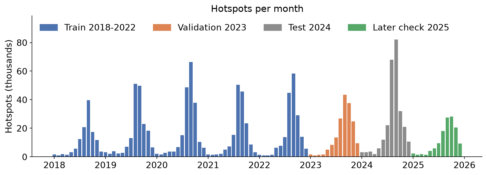
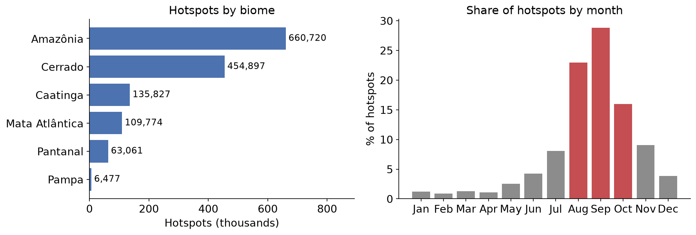
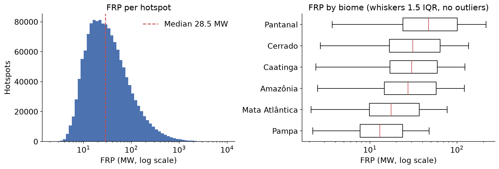
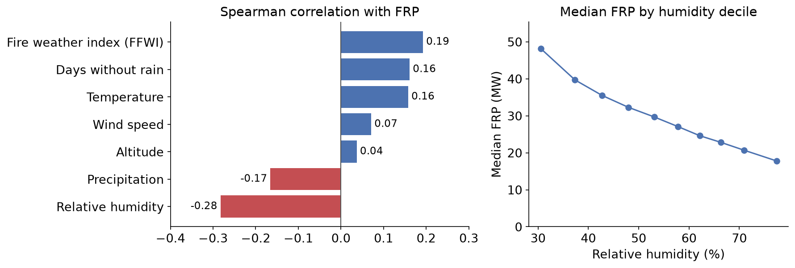

<!-- _class: lead -->
<!-- _paginate: false -->

# Brazil Wildfires: Predicting Fire Strength from Weather and Terrain

Dataset background, data sources, and modeling challenges

Foundations of Neural Networks

Group Data Presentation

Daniel Wang, James Povilonis, Jose Perales

---

# Motivation

- Like many countries, Brazil suffers from seasonal wildfires. From 2018 to 2025, satellites flagged **1.43 million active-fire hotspots** across the country.³
- Fires can last a long time. Drought in 2007 and 2010 "caused multiple fires to burn synchronously for **over 2 months** across tropical forests and savannas in South America."¹
- With satellites data, we get more than just tracking wildfire spread. Each detection also comes with **fire radiative power (FRP)**, an estimate of how intensely it's burning.²
- A detection tells responders **where** a fire is, but not whether it will be one of the intense ones. Weather, terrain, and land cover might help with that.
- Run on forecast weather, a model like this could help decide where to send firefighters first.

**Our question:** How much do weather, terrain, and land cover at a detected hotspot tell us about how intense the fire is?

> ¹ Andela et al., "The Global Fire Atlas of individual fire size, duration, speed and direction," 2019.
>
> ² Wooster et al., "Retrieval of biomass combustion rates and totals from fire radiative power observations," 2005.
>
> ³ Costa, "Banco Histórico de Incêndios no Brasil 2018–2025," Hugging Face, 2025.

---

# Amazon Forest Wildfires

- The Amazon is a vast, dense rainforest. For most of history, forest fires were rare.
- Forest fires move slowly, in contrast to massive blazes of North America.
- Flora in the rainforest are not adapted to these fires. 

> World Resources Institute. "South America's Forest Fires, Explained." WRI Insights, 2024
>
> Cochrane, Mark A. "Fire Science for Rainforests." Nature, vol. 421, no. 6926, 2003, pp. 913–919.

---

# Causes of the Wildfires

The Amazon was historically fire-resistant, but is experiencing increased seasonal wildfires. This change has several causes:
- **Forest Fragmentation**: As logging increasingly moves into the interior, more winds fuel the fires.
- **Climate Change**: Warming climate and more intense droughts have led to higher probabilities of fire outbreaks and more difficult containment. (
- **Direct Human Action**: Land speculation, slash-and-burn clearing, and varying environmental enforcement increase deforestation and creates more outbreaks (NC state)

> Bourgoin, C., et al. "Extensive Fire-Driven Degradation in 2024 Marks Worst Amazon Fire Season in Two Decades." Biogeosciences, 2025.
> 
> Dutra, Débora Joana, et al. "Fire Dynamics in an Emerging Deforestation Frontier in Southwestern Amazonia, Brazil." Fire, vol. 6, no. 1, 2022, p. 2.
> 
> Silveira, Marcus V. F., et al. "Drivers of Fire Anomalies in the Brazilian Amazon: Lessons Learned from the 2019 Fire Crisis." Land, vol. 9, no. 12, 2020, p. 516.
---

# Where the dataset comes from

- Published on **Hugging Face** by Mateus P. Costa (2025) as *Banco Histórico de Incêndios no Brasil 2018–2025* (Historical Fire Database for Brazil).³
- It covers **all of Brazil** and its six biomes from **2018 to 2025**, with one Parquet file per year.³
- The card lists **tabular classification and regression** as intended tasks.³

*Map: our EDA, all 1,430,756 hotspots.*

> ³ Costa, "Banco Histórico de Incêndios no Brasil 2018–2025," Hugging Face, 2025.

---

# Background on satellite fire detection

- **MODIS**, an instrument on NASA's Aqua satellite, uses thermal infrared to find unusually hot areas. Each detection covers a pixel of roughly 1 km.⁴
- A **hotspot** isn't necessarily a separate fire. A large wildfire can show up as many detections.⁴
- **FRP** (fire radiative power) measures how much energy a fire is radiating, in megawatts (MW), when the satellite passes overhead.²
- **FFWI** (Fosberg Fire Weather Index) combines temperature, humidity, and wind into a single measure of fire weather. It's one of the weather columns we can use as a feature.⁵

> ² Wooster et al., "Retrieval of biomass combustion rates and totals from fire radiative power observations," 2005.
>
> ⁴ Giglio, Schroeder & Justice, "The collection 6 MODIS active fire detection algorithm and fire products," 2016.
>
> ⁵ Fosberg, "Weather in wildland fire management: The fire weather index," 1978.

---

# How the dataset was built

*Our diagram, based on the dataset card.³*

- The dataset starts with **hotspots reported by INPE**, Brazil's National Institute for Space Research. Each has a location, detection time, FRP, and INPE's own rain and fire-risk fields. All come from Aqua's afternoon pass (`AQUA_M-T`).⁶
- The author then matched each hotspot with **that day's weather**, plus elevation and land cover for that location.³

> ³ Costa, "Banco Histórico de Incêndios no Brasil 2018–2025," Hugging Face, 2025.
>
> ⁶ INPE, Programa Queimadas (BDQueimadas).

---

# What does the dataset contain?

| Table | What it holds | Rows³ |
|---|---|---|
| **focos_analise** (what we use) | INPE hotspots + land cover, altitude, weather | 1,430,756 |
| focos_inpe | The same hotspots, raw from INPE | 1,430,756 |
| meteo_era5 | Daily ERA5 weather grid over Brazil | 84,025,032 |
| focos_firms | NASA FIRMS VIIRS detections, **2018 only** | 2,643,169 |

| Source | Resolution | Time coverage³ |
|---|---|---|
| INPE hotspots (MODIS) | ~1 km | Daily, 2018–2025 |
| ERA5 weather⁷ | 0.25° (~28 km) | Daily |
| MapBiomas land cover⁸ | 30 m | One map, 2021 |
| SRTM altitude⁹ | ~90 m | Static |

- The full dataset has about 89.5 million rows, but we're mainly using focos_analise because it joins fire intensity and environmental data.

> ³ Costa, 2025. ⁷ Hersbach et al., "The ERA5 global reanalysis," 2020. ⁸ Souza et al., "Reconstructing three decades of land use and land cover changes in Brazilian biomes," 2020. ⁹ Farr et al., "The Shuttle Radar Topography Mission," 2007.

---

# What does a row look like?

| Column | Meaning | Example |
|---|---|---|
| `data_hora_gmt` | Detection time (UTC) | 2023-01-02 17:11 |
| `latitude`, `longitude` | Hotspot location | −17.53, −57.66 (Cáceres, MT) |
| `bioma` | Biome | Pantanal |
| `nome_classe_mb` | MapBiomas land cover | Campo Alagado (flooded grassland) |
| `altitude_m` | SRTM altitude | 96 m |
| `temp_c`, `rh` | Daily temperature, relative humidity | 29.4 °C, 73.6% |
| `wind_speed`, `tp_mm` | Daily wind speed, precipitation | 1.9 m/s, 0.09 mm |
| `ffwi` | Fire weather index | 0.51 |
| **`frp`** (target) | Fire radiative power | 82.4 MW |

*Example: one hotspot from 2023, showing 12 of the 33 available columns.*

- The column names and categories are **in Portuguese**, so we've added English descriptions to make them easier to follow.

---

# Checking the dataset before modeling

| What we found | Why it matters |
|---|---|
| 2,540 rows (all in 2020) have no FRP | We can't train on these without a target value |
| The same 2,540 rows have a geometry up to ~50 m off their coordinates | The coordinates don't quite match, and we don't know why yet |
| 2,622 rows lack INPE's rain, dry-days, and fire-risk fields; 237 lack altitude | We'll need to decide how to handle these missing values |
| 26 days have no hotspots, including April 1–16, 2022 | This looks more like missing data than 16 days without any fires |
| `geometria` is written `POINT (lat lon)`, the reverse of the usual order | We need to be careful about coordinate order when using GIS tools |
| 689 rows report over a year without rain (max 827 days) | These look suspicious and need another look |

- Otherwise, our row counts **matched the dataset card**³ and we found no duplicate IDs.

> ³ Costa, "Banco Histórico de Incêndios no Brasil 2018–2025," Hugging Face, 2025.

---

# Preparing independent evaluation data

- Rather than splitting rows at random, we're splitting **by year**. We'll train on 2018–2022, validate on 2023, and test on 2024, with 2025 held aside as another check.
- Many hotspots share the same day's weather. Across 1.43 million rows, there are only 573,960 distinct day-and-weather combinations. A random split could put **very similar rows** in both training and test.
- 2024 has the **most hotspots** of any year (266,001), so it could be a harder test year.

---

# Hotspots cluster in two biomes and three months

*Our EDA: all 1,430,756 hotspots. Red: August to October.*

- About **78%** of detections come from Amazônia and Cerrado. Pampa has far fewer, with just 6,477 hotspots.
- Detections are also very seasonal. About **68%** happen between August and October, and September alone has nearly 29%.
- A model could do well overall but poorly in the less common biomes or months, so we should check those separately.

---

# Fire intensity is heavily skewed

*Our EDA: 1,428,216 hotspots with FRP. Boxes show quartiles; whiskers reach 1.5 IQR.*

- Most hotspots have fairly low FRP. The median is **28.5 MW**, but a small number of very intense detections (up to 9,612 MW) pull the mean up to 63.1 MW.
- Just 1% of hotspots account for **16.9% of the total FRP**, and 5,182 detections are above 1,000 MW.
- FRP also varies by biome, from a median of 13.0 MW in Pampa to 47.1 MW in Pantanal. Since it's so skewed, we plan to model **log FRP** instead of raw FRP.

---

# Drier weather is correlated with more intense fires

*Our EDA: hotspots with FRP, all years. Rank correlations only, with no control for biome or season.*

- Of the variables we looked at, **humidity** stands out most (ρ = −0.28). Median FRP falls from 48.2 MW in the driest tenth of hotspots to 17.8 MW in the most humid tenth.
- Temperature, days without rain, and FFWI have weaker positive correlations (ρ ≈ 0.16 to 0.19). Surprisingly, wind speed on its own has almost none (0.07).
- Weather changes with the seasons, so some of these relationships likely reflect **seasonal differences** rather than the effect of any one variable.

---

# What might the data predict?

Based on what we've seen so far, these are the hypotheses we're considering to test.

| Question we want to answer | Why we think it could work | What makes it difficult |
|---|---|---|
| **H1** Can we estimate a hotspot's FRP from weather, terrain, and land cover? | We already see some links between weather and FRP | The correlations are fairly weak at \|ρ\| ≤ 0.28 |
| **H2** Does weather tell us anything beyond location and time of year? | Weather varies even within the same season | Weather and season are closely related |
| **H3** Do some biomes and land covers have higher FRP? | Pantanal's median FRP is 3.6× Pampa's | Some biomes, like Pampa, have far fewer examples |
| **H4** Can we pick out unusually intense hotspots? | The highest FRP values may share recognizable conditions | Those extreme hotspots are rare |

---

# Limitations

- We only have data for fires the satellite **detected**. We can study intensity, but we can't use this table alone to predict where new fires will start.³
- We're relying on **one satellite's afternoon pass**. Fires can be missed if they're under cloud, burn at night, or happen between passes.⁴
- The weather is much **coarser** than the hotspots: one daily value for an area about 28 km across. The card doesn't say how ERA5's hourly values were combined.³
- FFWI in this dataset only ranges from **0 to 4.8**. We suspect it isn't on Fosberg's original scale, but we can't confirm that from the card.³ ⁵
- The land cover map is from **2021**, while the hotspots span 2018–2025. Some places may have changed in between.

> ³ Costa, 2025. ⁴ Giglio, Schroeder & Justice, 2016. ⁵ Fosberg, 1978.

---

# Why the dataset is useful

- The weather, terrain, and land cover are **already matched** to the fire detections, so we don't have to build those joins ourselves.³
- With **eight years** of data, we can test on different years instead of relying on a random split.
- The **full ERA5 weather grid** (84 million rows) is included too. With more work, it could support a different project on where fires occur, not just how intense they are.³
- Products like the Global Fire Atlas focus on burned area and fire duration.¹ This one gives us an **FRP value for each detection**, along with the joined weather data.

> ¹ Andela et al., "The Global Fire Atlas of individual fire size, duration, speed and direction," 2019.
>
> ³ Costa, "Banco Histórico de Incêndios no Brasil 2018–2025," Hugging Face, 2025.

---

# Conclusions

- This dataset is a good fit for our question. It has **eight years** of hotspots with weather, terrain, and land cover already attached.
- Hotspots aren't spread evenly. Most fall in **two biomes and a few months**, and a small number have very high FRP.
- Weather seems related to FRP, but the correlations **aren't very strong**. We still need to see whether they hold up once we account for location and season.
- There are some **data quality issues** to deal with first, like missing values, suspicious records, and gaps in coverage.
- **Our question going into modeling:** How much do weather, terrain, and land cover at a detected hotspot tell us about how intense the fire is?

---

<!-- _class: refs -->
<!-- _paginate: false -->

# References

1. Andela, N., Morton, D. C., Giglio, L., Paugam, R., Chen, Y., Hantson, S., van der Werf, G. R., & Randerson, J. T. (2019). The Global Fire Atlas of individual fire size, duration, speed and direction. *Earth System Science Data*, 11, 529–552. https://doi.org/10.5194/essd-11-529-2019
2. Wooster, M. J., Roberts, G., Perry, G. L. W., & Kaufman, Y. J. (2005). Retrieval of biomass combustion rates and totals from fire radiative power observations: FRP derivation and calibration relationships between biomass consumption and fire radiative energy release. *Journal of Geophysical Research: Atmospheres*, 110, D24311. https://doi.org/10.1029/2005JD006318
3. Costa, M. P. (2025). *Banco Histórico de Incêndios no Brasil 2018–2025* [Data set]. Hugging Face. https://huggingface.co/datasets/mateus-pcosta/brazil-wildfire-geospatial-dataset
4. Giglio, L., Schroeder, W., & Justice, C. O. (2016). The collection 6 MODIS active fire detection algorithm and fire products. *Remote Sensing of Environment*, 178, 31–41. https://doi.org/10.1016/j.rse.2016.02.054
5. Fosberg, M. A. (1978). Weather in wildland fire management: The fire weather index. In *Proceedings of the Conference on Sierra Nevada Meteorology* (pp. 1–4). American Meteorological Society.
6. Instituto Nacional de Pesquisas Espaciais (INPE). (n.d.). *Programa Queimadas*. https://terrabrasilis.dpi.inpe.br/queimadas/portal/
7. Hersbach, H., et al. (2020). The ERA5 global reanalysis. *Quarterly Journal of the Royal Meteorological Society*, 146(730), 1999–2049. https://doi.org/10.1002/qj.3803
8. Souza, C. M., Jr., et al. (2020). Reconstructing three decades of land use and land cover changes in Brazilian biomes with Landsat archive and Earth Engine. *Remote Sensing*, 12(17), 2735. https://doi.org/10.3390/rs12172735
9. Farr, T. G., et al. (2007). The Shuttle Radar Topography Mission. *Reviews of Geophysics*, 45, RG2004. https://doi.org/10.1029/2005RG000183
